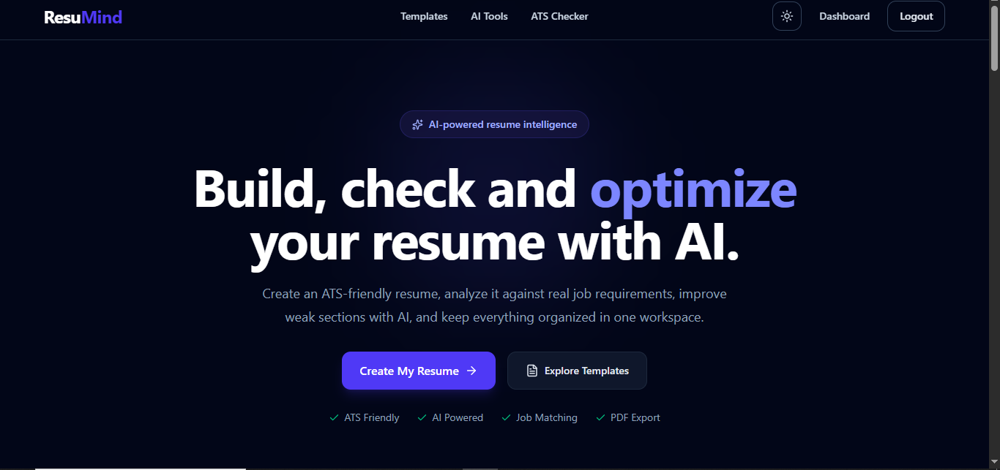
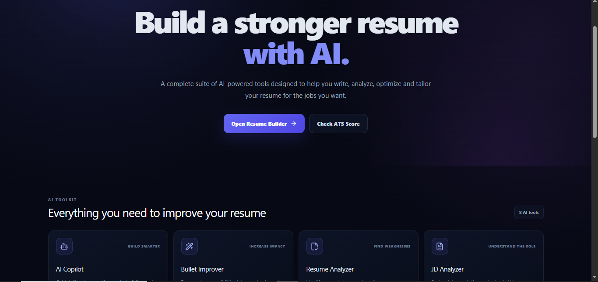
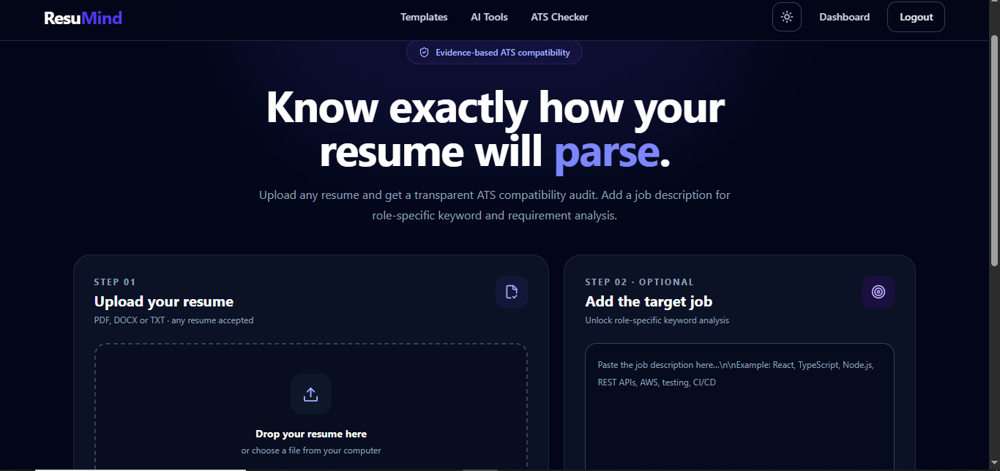
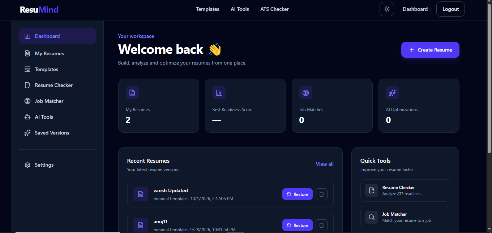

# ResuMind
### AI-Powered Resume Builder & ATS Optimization Platform

<p align="center">
  Build Smarter. Optimize Better. Get Hired Faster.
</p>

<p align="center">
  A full-stack AI-powered platform that helps job seekers build professional resumes, analyze ATS compatibility, and optimize their applications with intelligent AI assistance.
</p>

<p align="center">
  
  
  
  
  
</p>

---

## Overview

**ResuMind** is a full-stack resume creation and optimization platform designed to simplify the job application process.

It combines a professional resume builder, ATS analysis engine, and AI-powered career tools into one platform.

Users can create and manage resumes, evaluate their ATS compatibility, identify missing job-related keywords, improve resume content, and receive actionable suggestions using Google Gemini AI.

## Key Features

### 1. AI-Powered Resume Analysis
- AI-generated ATS compatibility score.
- Resume strengths and weaknesses identification.
- Missing keyword detection.
- Actionable improvement recommendations.
- Technical and soft skills analysis.

### 2. Professional Resume Builder
- Create and edit resumes with structured sections.
- Multiple resume templates.
- Real-time resume preview.
- Save and manage multiple resumes.
- Download resumes as PDF.

### 3. Advanced ATS Checker
- Upload existing resumes.
- Extract resume text for analysis.
- Analyze resume compatibility.
- Compare resume keywords against job descriptions.
- Identify detected and missing keywords.
- Highlight areas that need improvement.

### 4. AI Studio

A collection of AI-powered tools designed to improve resume quality.

| Tool | Functionality |
|---|---|
| Resume Analyzer | Evaluates resume quality and ATS compatibility |
| Resume Optimizer | Improves resume content and structure |
| Bullet Improver | Enhances experience and project bullet points |
| JD Analyzer | Extracts required skills and job responsibilities |
| Skills Intelligence | Suggests relevant skills with reasoning |
| Resume Copilot | Assists with resume content improvement |
| Job Match | Compares resume skills with job requirements |
| One-Page Resume | Helps optimize resume content for one-page formatting |

### 5. Secure Resume Management
- User authentication and authorization.
- JWT-based authentication.
- Password hashing with bcryptjs.
- MongoDB-backed resume storage.
- Create, read, update, and delete operations.

---

## Technology Stack

| Category | Technologies |
|---|---|
| Frontend | React.js 19, Vite, JavaScript |
| Styling | Tailwind CSS |
| UI Icons | Lucide React |
| Backend | Node.js, Express.js |
| Database | MongoDB, Mongoose |
| Authentication | JWT, bcryptjs |
| AI Integration | Google Gemini API |
| API Communication | Axios |
| Development Tools | Git, GitHub, VS Code |

---

## 📸 Application Screenshots

### 🏠 Home Page


### 🤖 AI Tools


### 📊 ATS Checker


### 💻 Dashboard


---

## System Architecture

```text
                  ┌─────────────────────┐
                  │      User           │
                  └──────────┬──────────┘
                             │
                             ▼
                  ┌─────────────────────┐
                  │   React Frontend    │
                  │  Resume Builder UI  │
                  │     ATS Checker     │
                  │      AI Studio      │
                  └──────────┬──────────┘
                             │
                         REST API
                             │
                             ▼
                  ┌─────────────────────┐
                  │   Express Backend   │
                  │ Authentication      │
                  │ Resume APIs         │
                  │ AI APIs              │
                  └──────┬────────┬─────┘
                         │        │
               ┌─────────▼──┐  ┌──▼────────────┐
               │  MongoDB   │  │ Gemini API    │
               │  Database  │  │ AI Processing │
               └────────────┘  └───────────────┘
```

## Project Structure

```text
ResuMind/
│
├── backend/
│   ├── ai/
│   │   ├── documentParser.js
│   │   └── resumeAnalyzer.js
│   │
│   ├── middleware/
│   │   ├── authMiddleware.js
│   │   └── uploadMiddleware.js
│   │
│   ├── routes/
│   │   ├── authRoutes.js
│   │   ├── resumeRoutes.js
│   │   └── aiRoutes.js
│   │
│   ├── server.js
│   └── package.json
│
├── frontend/
│   ├── src/
│   │   ├── components/
│   │   ├── pages/
│   │   └── ...
│   └── package.json
│
└── README.md
```

## Getting Started

Follow these instructions to run ResuMind locally.

### Prerequisites

- Node.js (v22 recommended)
- MongoDB database
- Google Gemini API key
- Git

### 1. Clone the Repository

```bash
git clone https://github.com/Priy ansh-Gurjar20/ResuMind.git
cd ResuMind
```

### 2. Configure Backend

```bash
cd backend
npm install
```

Create a `.env` file inside the backend directory:

```env
PORT=5000
MONGO_URI=your_mongodb_connection_string
JWT_SECRET=your_jwt_secret
GEMINI_API_KEY=your_gemini_api_key
```

Start the backend:

```bash
npm run dev
```

### 3. Configure Frontend

Open another terminal:

```bash
cd frontend
npm install
npm run dev
```

### 4. Open the Application

Open the local frontend URL displayed by Vite in your browser.

---

## Environment Variables

| Variable | Description |
|---|---|
| PORT | Backend server port |
| MONGO_URI | MongoDB connection string |
| JWT_SECRET | Secret used for JWT authentication |
| GEMINI_API_KEY | Google Gemini API key |

**Security:** Never commit `.env` files, database credentials, or API keys to version control.

---

## Future Enhancements

- Google OAuth authentication.
- More professional resume templates.
- Advanced job recommendation engine.
- Enhanced ATS scoring methodology.
- Resume version comparison.
- Cloud-based resume export and sharing.

---

## Developer

**Priyanshu Gurjar**

B.Tech – Computer Science & Engineering

GitHub: [@Priyanshu-Gurjar20](https://github.com/Priyanshu-Gurjar20)

---

<p align="center">
  <b>ResuMind — Build Smarter. Optimize Better. Get Hired Faster.</b>
</p>

<p align="center">
  If you find this project useful, consider giving it a ⭐ on GitHub.
</p>
